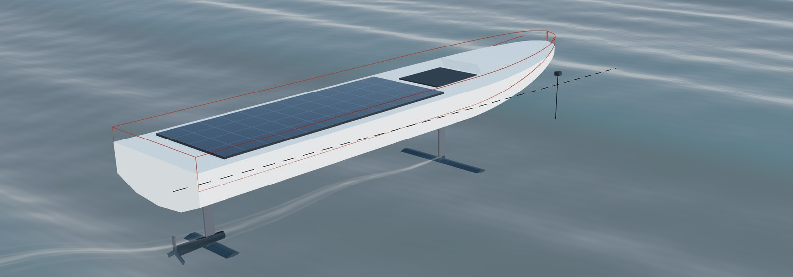

<p align="center"></p>

# Ride-height control of a fully submerged hydrofoil boat

[](https://www.mathworks.com/products/matlab.html)
[](https://www.mathworks.com/products/simulink.html)
[](paper/paper.pdf)

Observer-based digital control of the heave and pitch of a small solar-powered
hydrofoil boat, with parameters of the Técnico Solar Boat SR02. Course project for
ELEC9304 Control, The University of Sydney, 2026. Shengwei Li and Hengfei Xu.

## The problem

A fully submerged foil gives almost the same lift at any depth, so the boat has
no ride-height stiffness: linearised at 7 m/s it is open-loop unstable and close
to a double integrator in heave. It has four states and three sensors (an
ultrasonic height sensor at the bow, an AHRS for pitch and a rate gyro), and the
height sensor measures the distance to the water surface, so it sees the waves
as well as the boat.

## Approach

- **Model.** First-principles nonlinear heave and pitch dynamics with the loss of
  lift near the free surface, stall, actuator position and rate limits, servo
  lag, sensor noise, and regular or JONSWAP head seas. Checked against the trim
  of the SR02 thesis (within about 0.1° from 6 to 10 m/s).
- **Controller.** LQR with integral action on the estimated height and the
  measured pitch, reference prefilter and anti-windup, and a Kalman filter with
  a constant-force bias state. The wave surface in the height reading is modelled
  as narrow-band noise, so the filter does not follow it.
- **Observer comparison.** Pole-placement observers designed by the usual rule
  recover faster from a speed error but follow the water surface: four times the
  height error in waves and foils at their rate limit. Placing the poles where
  the Kalman filter puts them is not enough: with a speed error the boat
  diverges.
- **Digital implementation.** Discrete design at 50 Hz with a one-sample
  computation delay.
- **Software in the loop.** The same controller runs as a separate MATLAB process
  and exchanges sensor readings and commands with the Simulink model over TCP,
  in lockstep or in real time.

## Results

Nonlinear model with actuator limits, sensor noise and waves:

| Test | Result |
|---|---|
| 5 cm height step, calm water | settles in 2.16 s, no overshoot |
| 5 cm regular head waves | height error 0.99 cm rms, pitch 0.33° rms |
| Irregular seas, Hs 0.10 / 0.15 / 0.25 m | 0.7–0.8 / 1.8–2.2 / 3.6–4.9 cm rms |
| Speed 6–8 m/s, mass 195–235 kg | zero steady-state error; stable over 5.9–9 m/s, 190–240 kg |
| Controller as a separate real-time process | identical to the in-model controller; one sample of extra delay leaves the error unchanged, two samples double it |

## Repository

```
paper/              IEEE paper (paper.pdf) and its LaTeX source
matlab/             model, controller design, simulations, Simulink model
  README.md         file-by-file guide
  simulink_guide.html   the Simulink model explained block by block
viz/                3D view in the browser and the telemetry bridge
start_sil.bat       starts the software-in-the-loop demo
model_derivation.pdf    derivation of the model (development notes)
control_design.pdf      controller design notes and decision log
```

## Getting started

Requirements: MATLAB R2024b with Simulink and the Control System Toolbox. The 3D
view also needs Python 3 (standard library only) and a browser with internet
access.

Open `matlab/hydrofoil_sim.slx` and press Run: a 5 cm height step in regular
waves with sensor noise, controlled at 50 Hz. Run the scripts with `matlab/` as
the current folder.

| Paper | Script |
|---|---|
| linear model, eigenvalues, ranks, trim table | `run_openloop` |
| LQR gains and poles | `run_lqr` |
| Kalman filter, separation principle | `run_observer` |
| observer comparison (Table III) | `run_observer_compare` |
| digital design, sample rate, robustness | `run_digital` |
| irregular seas (Table IV) | `run_irregular` |
| Simulink checks | `run_simulink` |
| software in the loop (Fig. 9) | `run_sil` |
| all figures | `make_paper_figs` |

## Software in the loop

1. Double-click `start_sil.bat`, or run `ctrl_server` in a second MATLAB, and
   wait for `Controller listening on port 5501`.
2. Run `run_sil` for the timing tests, or `run_sil_demo` for a 30 s real-time run
   in the 3D view at http://localhost:8000.

Details: `matlab/README.md` (section 6.4) and `viz/README.md`.

## Limitations

All results are from simulation. Lift is quasi-steady, the waves are linear and
long-crested from ahead without roll, and the chord, foil submergence, sensor
noise and actuator rate are estimates. Both processes of the software-in-the-loop
test run on one computer.

## References

The model parameters come from B. J. Belime, *An hydrofoil control system for
the SR02 vessel in the scope of the Técnico Solar Boat Project*, M.Sc. thesis,
Instituto Superior Técnico, 2020. The full reference list is in the paper.
